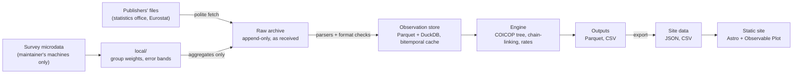

# Architecture

The pipeline is a Python package, `src/traceconomics/`. The website is a static Astro site in
`site/`. Data move in one direction, and each stage can be rebuilt from the one before it, except
the raw archive, which is the record.

## Data flow

1. **Sources** (`sources/`). One adapter per publisher finds and fetches its files: `elstat/`,
   `eurostat/` and `ec_empl.py`, plus `terms.py`, which watches those publishers' reuse terms and
   alerts when they change. AADE's yearly workbooks are the exception: its CDN refuses requests from
   cloud servers, so they are downloaded by hand and added with `traceconomics import --source aade`,
   and `aade/` only names and parses them. `base.py` is the shared HTTP client: one request at a time, a pause between requests, a
   User-Agent naming the project, retries with growing waits, `robots.txt` respected. Publishers'
   release calendars decide when the job runs.
2. **Raw archive** (`archive/store.py`). Every file is stored exactly as received, with a manifest
   (URL, time, HTTP headers, SHA-256). A new snapshot is kept only when the content changed.
   Nothing is ever changed or deleted. It lives outside the repository, in a folder set by the
   config. Microdata datasets are listed as local-only (`archive/local_only.py`,
   `data/local_only.toml`) and every publishing or copying step refuses them.
3. **Observation store** (`store/`). Parsers read each archived file once into Parquet files,
   queried with DuckDB. It is a cache: `traceconomics store rebuild` gives it back from the archive.
   Which datasets are parsed, and how, is data, not code: `data/datasets.toml`, read by
   `catalog.py`.
4. **Engine** (`engine/`). The arithmetic, with no method choices: the COICOP tree with its leaves
   and parent fallback, chain-linking each year's index at December of the year before, and rates.
   `validate/` checks it against official figures before anything else uses it.
5. **Topic code** (`module1/` for inflation by household group). Weights timing, prices, indices,
   rates, contributions and every option combination, written as Parquet and CSV.
6. **Export** (`export/`). The small files the site reads: series, the calculator's inputs,
   category names in both languages, and the bibliography.
7. **Site** (`site/`). Static pages built at build time from those files. The browser computes
   nothing but the personal calculator.

Survey microdata are read only by `local/`, in memory, on the maintainer's own machines. Only
aggregates (spending shares by group, income limits, standard errors) go back into the archive, as
the project's own dataset, and from there into the store like any other source.

## Package map

| Path                        | Role                                                                                             |
| --------------------------- | ------------------------------------------------------------------------------------------------ |
| `cli.py`, `__main__.py`     | The command line, `python -m traceconomics <command>`                                            |
| `config.py`                 | User settings from a TOML file outside the repository                                            |
| `job.py`                    | The scheduled job: is a release due, fetch, report, then the follow-up steps                     |
| `sources/`                  | Publisher adapters, parsers, reuse-terms watch, the polite HTTP client                           |
| `archive/`                  | The append-only raw archive and the local-only list                                              |
| `store/`                    | The observation store: build from the archive, query as of a date                                |
| `catalog.py`, `data/`       | Reference data: datasets, country codes, mapping tables, published figures used in checks        |
| `checks.py`                 | `FormatError`: parsers refuse a file that doesn't look as expected                               |
| `engine/`                   | COICOP tree, chain-linking, rates                                                                |
| `validate/`                 | The engine against official figures                                                              |
| `module1/`                  | Inflation by household group                                                                     |
| `local/`                    | Microdata: groups, shares, bootstrap standard errors, error bands, code mapping (optional extra) |
| `export/`                   | Published files for the site                                                                     |
| `references/`               | The bibliography, `references.bib`                                                               |
| `release.py`                | A release build: recompute, check, build and test the site, upload a private preview             |
| `notify.py`, `heartbeat.py` | Run reports, and a heartbeat after every run                                                     |

## Bitemporal storage

Every row in the store is one value of one series for one period, as known from one archived
snapshot. It carries two times: when the source published it (`published_at`) and when we fetched
it (`retrieved_at`), plus the hash of the raw file it came from and the parser version that read
it.

A snapshot adds a row only where it differs from the previous snapshot of the same archived file:
a new value, a revised one, or a value that disappeared (a `withdrawn` row). Comparing within one
file matters because a dataset can be fed by many files (one per year, for some tables); a file for
one year must not "withdraw" values it never held.

So the store answers "what was known on a given date?" (`store/query.py`, `as_of`), revisions are
never lost, and flash and final estimates can sit side by side. A back series, computed after the
fact rather than published at the time, is flagged as such.

## Reproducibility

The same archive gives byte-identical outputs and site files on any machine, x86 or Arm. Three
rules keep it so:

- every query whose rows feed an output or a sum has an `ORDER BY` (row order changes the last
  digits of a floating-point sum);
- text is written with `\n` line endings;
- Parquet is written through `module1.output.parquet_connection()`, which uses one thread: DuckDB's
  row groups otherwise follow its per-thread chunks, so machines with different core counts would
  write different files.

Dependencies are pinned exactly and installed from hashed lock files, and production runs use a
container image pinned by digest, so builds run on the interpreter and libraries the tests ran on.

## Releases

A release build recomputes every series, runs the checks, writes the site's data, builds the site,
runs the browser tests on the built files, uploads it as a private preview, and runs the smoke
tests again on the preview, where the host's real headers apply. A failure holds the build back.
Nothing reaches the public address until a maintainer looks at the preview and promotes the build;
after a promote, the address is checked to serve that build's own files.

## Publishing

Data are published as static files, not through a live database: Parquet for every option
combination, CSV for the default setting and for the index and rates of every setting, each value
with its source. A queryable API may come later; the layout allows adding one without a rewrite.

---

_This page is kept in the repository, in [`wiki/Architecture.md`](https://github.com/agardelakos/traceconomics/blob/main/wiki/Architecture.md), and copied here automatically. Changes go through a pull request; an edit made here is replaced at the next update._
